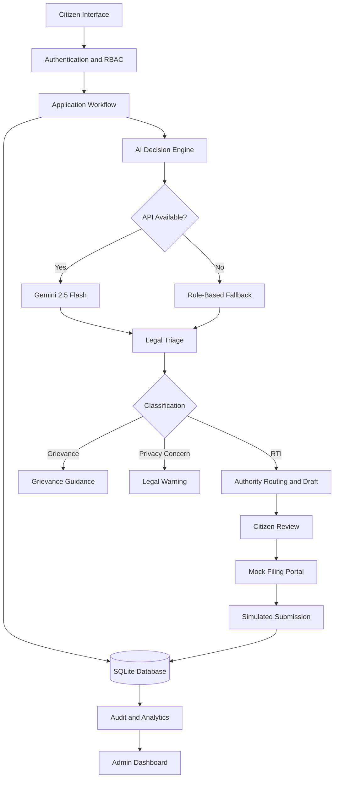

# 🏛️ Nagarik RTI Assistant
### AI-Powered Legal Routing & Filing Engine

> **Mission:** Simplifying access to the Right to Information (RTI) Act, 2005, through multilingual AI, intelligent legal triage, and automated application drafting.

Nagarik RTI Assistant is a GovTech platform that helps citizens convert informal queries into structured RTI applications. It combines Gemini 2.5 Flash, rule-based fallback processing, public authority routing, and an interactive filing simulation to make information requests more accessible.

## 🛑 Problem Statement

- **Language barriers:** Citizens struggle to prepare formal applications in English or legal Hindi.
- **Request misclassification:** Grievances are often submitted through RTI channels instead of appropriate complaint mechanisms.
- **Privacy concerns:** Requests for third-party personal information may involve legal exemptions.
- **Complex procedures:** Identifying the correct public authority and navigating filing portals can be difficult.
- **Administrative workload:** Incomplete or misdirected requests create unnecessary processing overhead.

## 💡 Key Features

- **🧠 Intelligent Legal Triage:** Classifies requests as information requests, service grievances, potentially restricted personal-information requests, or ambiguous cases.
- **🌐 Multilingual AI:** Supports Hindi, Marathi, Tamil, and English input and structured application drafting.
- **🏛️ Authority Routing:** Recommends relevant departments based on the request subject and jurisdictional details.
- **📝 Automated Drafting:** Generates structured RTI application drafts for citizen review.
- **🔄 Fault-Tolerant Processing:** Uses deterministic fallback rules when the Gemini API encounters timeouts, rate limits, or connectivity failures.
- **🔐 Role-Based Access Control:** Separates citizen functions from administrative oversight and audit dashboards.
- **🔏 Application Traceability:** Associates application events with a stable identifier and records workflow status.
- **🤖 Filing Simulation:** Demonstrates CAPTCHA verification, simulated fee processing, and mock registration-number generation.
- **📊 Admin Analytics:** Provides application statistics, classification summaries, and workflow monitoring.

## 🏗️ System Architecture



## ⚙️ Technology Stack

| Component | Technology |
|---|---|
| User interface | Streamlit |
| Backend logic | Python |
| LLM | Gemini 2.5 Flash |
| Database | SQLite |
| Browser automation | Playwright |
| Document generation | ReportLab, if used |
| Version control | Git and GitHub |

## 🚀 Installation and Setup

### 1. Clone the repository

```bash
git clone https://github.com/devesh6386/Nagarik-RTI-Assistants.git
cd Nagarik-RTI-Assistants
```

### 2. Create and activate a virtual environment

**macOS / Linux**

```bash
python3 -m venv .venv
source .venv/bin/activate
```

**Windows**

```bash
python -m venv .venv
.venv\Scripts\activate
```

### 3. Install dependencies

Create or update `requirements.txt` with the packages your project actually imports, then run:

```bash
python -m pip install --upgrade pip
pip install -r requirements.txt
```

### 4. Configure the Gemini API

Create a `.env` file in the project root and add your API key:

```text
GEMINI_API_KEY=your_api_key_here
```

Keep this file private and exclude it from Git using `.gitignore`.

### 5. Initialize and launch Streamlit

If your main application file is `app.py`, run:

```bash
streamlit run app.py
```

Streamlit will display the local application URL in your terminal, usually `http://localhost:8501`.

To stop the server, press `Ctrl+C`.

## 📦 Python Libraries and Dependencies

The following is a proposed dependency list based on the described features. Keep only the packages required by your actual source files.

| Library | Purpose |
|---|---|
| `streamlit` | Web interface and interactive dashboards |
| `google-genai` | Gemini API integration using the modern Google Gen AI SDK |
| `python-dotenv` | Loading API credentials from `.env` |
| `playwright` | Browser automation for the mock filing portal |
| `reportlab` | PDF generation, if used |
| `pytest` | Automated testing, if configured |

Example `requirements.txt`:

```text
streamlit
google-genai
python-dotenv
playwright
reportlab
pytest
```

Install the browser required by Playwright, if your implementation uses its Chromium browser:

```bash
playwright install chromium
```

**Python standard-library modules do not need installation.** Modules such as `sqlite3`, `os`, `json`, `re`, `hashlib`, `uuid`, `datetime`, and `random` are included with Python.

If your current code uses the older `google-generativeai` SDK instead of `google-genai`, retain the package your code imports rather than installing both unnecessarily.

## 🔐 Security and Reliability

- Backend-enforced authorization for citizen and admin routes.
- Secure handling of API credentials and application records.
- Deterministic validation and fallback processing for supported scenarios.
- Stable application identifiers and auditable workflow events.
- Human review for ambiguous or potentially sensitive legal requests.
- Appropriate data minimization and access restrictions.

## 🌱 Future Enhancements

- Verified public authority directory and jurisdiction-aware routing.
- Additional Indian languages and accessibility improvements.
- Retrieval-augmented generation grounded in official legal sources.
- PostgreSQL support for production-scale workloads.
- Secure document storage and application-status notifications.
- Automated evaluation of classification and routing accuracy.
- Integration with official filing services where authorized and supported.

## 🏁 Project Vision

Nagarik RTI Assistant aims to make public-information requests easier to understand, prepare, and track. By combining AI-assisted drafting with rule-based validation, fault tolerance, and human oversight, it provides a foundation for more accessible and transparent digital governance.

> **Disclaimer:** The platform assists with request preparation and legal awareness; it does not provide binding legal advice. Unless a verified official integration exists, CAPTCHA, payment, filing, and registration workflows are simulations and do not constitute an actual government submission.
